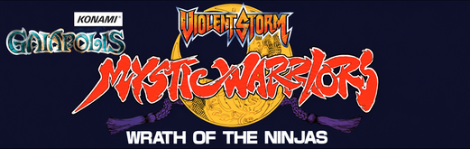
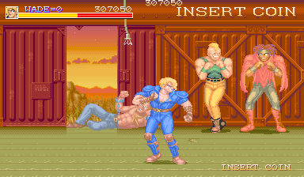
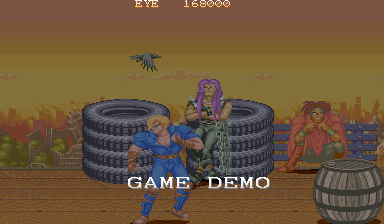
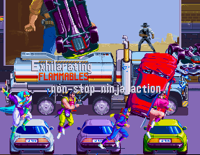
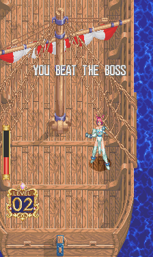

# Konami pre-GX — Analogue Pocket openFPGA

A multi-game Konami arcade core for **Analogue Pocket**, by **mmmax4**, based on
[plasticbugs / Scott's Gaiapolis core](https://github.com/plasticbugs/analogue-pocket-gaiapolis).

**Release [0.3](https://github.com/mmmax4/openFPGA-Konami-PreGX/releases/tag/v0.3)**
adds **Violent Storm**, incorporates Gaiapolis 0.3.2 graphics/audio improvements,
and preserves Mystic Warriors' confirmed intro-name workaround from 0.2.1.
The missing sprite rows seen in earlier Violent Storm builds are confirmed
resolved in Pocket gameplay and the final attract/demo scene.

## Game support

| Game / verified target revision | Status |
| --- | --- |
| **Gaiapolis (ver EAF)** | **Playable, tested on Pocket**; vertical presentation |
| **Mystic Warriors (ver EAA)** | **Playable, tested on Pocket**; intro-name workaround retained |
| **Violent Storm (ver EAC)** | **Playable, tested on Pocket**; horizontal presentation |
| Metamorphic Force (ver EAA) | Planned |
| Martial Champion (ver EAB) | Planned |
| Monster Maulers (ver EAA) | Planned |

Only the three playable profiles appear in the game menu and banner. Other
revisions and clones are not automatically supported.

## Install

Download **mmmax4.pregx-v0.3.zip** from the
[release page](https://github.com/mmmax4/openFPGA-Konami-PreGX/releases/tag/v0.3).
Copy **Cores/**, **Platforms/**, **Assets/** and **Presets/** to the SD root,
merging their contents. **Presets is required** for the correct per-game menu
labels. Keep existing original ROMs and saves. Open **Arcade Multi → Konami pre-GX**.

The SD package contains only those four runtime trees and one README.txt.
ROM builders, source and development documents stay in the repository and the
separate **mmmax4.pregx-v0.3-source.zip** download. See
[original ROM setup](docs/ROM_SETUP.md); no ROM, factory EEPROM or save is supplied.

## Features and validation

The shared menu provides game selection, independent per-game EEPROM settings,
Test/Service assignments, actual board DIP switches and display options.
Opening the Pocket core-options menu freezes the game. Gaiapolis retains its
vertical presentation. Mystic Warriors' scene-specific name workaround remains
enabled; [explanation and before/after captures](docs/INTRO_WORKAROUND.md).
No game program, graphics, ROM or EEPROM is patched.

Physical Pocket testing confirms the three games work with this hardware.
Violent Storm captures cover gameplay, second-stage action and the previously
affected final demo scene. The ordinary transition fade in that capture is
expected. This is a precise scene/gameplay observation, not a complete
playthrough claim. [Validation details](docs/VALIDATION.md).

The creator Info icon now uses the [mmmax4 GitHub avatar](docs/CREATOR_ICON.md).
Analogizer CRT/SNAC and high-score persistence remain separately unqualified.

## Pocket screenshots

Original Pocket captures, exported losslessly with their native pixels and
orientation. [All 13 captures and provenance](docs/POCKET_0.3.md).

## Source and credits

[Changes](CHANGELOG.md) · [Build](docs/BUILD.md) · [ROM setup](docs/ROM_SETUP.md) ·
[References](docs/REFERENCES.md) · [Credits](CREDITS.md) · [Licensing](LICENSING.md)

Applicable project code retains [GNU GPLv3](LICENSE). Original component-specific
terms remain in effect, including inherited Analogizer noncommercial notices;
[their compatibility assessment is unchanged](LICENSING.md#inherited-noncommercial-terms).
Corresponding source accompanies each release. The single SD README contains
required notices and license texts; source keeps its normal license files.

Related Pocket projects: [Asterix](https://github.com/mmmax4/openFPGA-Asterix)
and [MooBucky](https://github.com/mmmax4/openFPGA-MooBucky).
