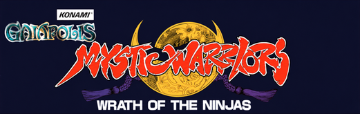
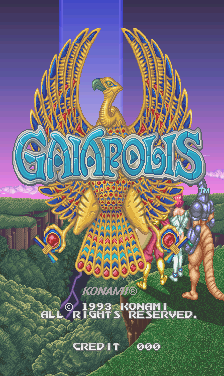
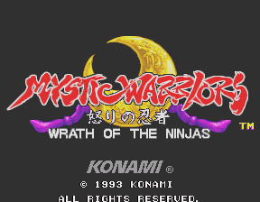
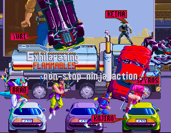
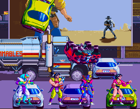
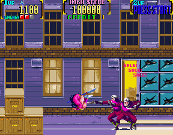
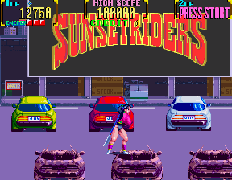

# Konami pre-GX — Analogue Pocket openFPGA

  

A multi-game Konami arcade core for **Analogue Pocket**, by **mmmax4**, based on
[plasticbugs/Scott's Gaiapolis core](https://github.com/plasticbugs/analogue-pocket-gaiapolis).

The goal is to support the games in Konami's pre-GX `mystwarr` hardware family
through one shared core and game menu. **Only Gaiapolis and Mystic Warriors are
currently playable.** The other games below are development goals.

  
  

**License:** [GNU GPLv3](LICENSE) for the applicable project code. Original
third-party licenses and notices remain in effect; see [licensing](LICENSING.md).

Some inherited Analogizer dependencies have noncommercial terms. These are
component-specific terms, preserved separately from the project's GPL license.
See [inherited dependency terms](LICENSING.md#inherited-noncommercial-terms).

## Game support

| Game / verified target revision | Current status |
| --- | --- |
| **Gaiapolis (ver EAF)** | **Playable**, tested on Pocket; vertical presentation |
| **Mystic Warriors (ver EAA)** | **Playable**, tested on Pocket; intro-name workaround included |
| Violent Storm (ver EAC) | Planned — next game to integrate |
| Metamorphic Force (ver EAA) | Planned |
| Martial Champion (ver EAB) | Planned |
| Monster Maulers (ver EAA) | Planned |

The banner shows the two currently playable games. Each additional logo will
return to its original position when its game becomes playable; see
[banner layout](docs/BANNER.md).

Planned profiles are not exposed as playable selections. Additional revisions
and clones are not automatically supported.

## Current development status

The current release is **0.2.1**, using the **intro01** hardware tested on Pocket.
The user confirms that the ninja names disappear after their portrait scene
and that Mystic Warriors and Gaiapolis continue to run well. Earlier audio,
intro-lettering and split-white transition fixes are retained. A complete
Mystic Warriors playthrough was reported on an earlier build; a new complete
playthrough of this release is not claimed.

### Mystic Warriors: lingering intro names

The five portrait name labels previously remained red over the following
truck scene. Release **0.2.1** includes a deliberately narrow **scene-specific
compatibility workaround**: it recognizes the original eight name descriptors
and the post-portrait layer layout, then omits those entries from the draw list.
Portrait names and normal captions are preserved. Gaiapolis bypasses the rule.
It does not patch the game program, graphics, ROMs or EEPROM, and it is not
presented as a proven general rule of the original sprite chip.

<table align="center">
  <tr><th align="center">Before — 0.2.0 / Pocket04</th><th align="center">After — 0.2.1 / tested intro01</th></tr>
  <tr><td align="center"></td><td align="center"></td></tr>
</table>

<em>Real Pocket captures at different moments of the same intro
sequence; lossless exports, without retouching.</em>

The disappearance is confirmed by the user's Pocket test. The screenshots
illustrate the truck scenes; they are not a frame-by-frame boundary measurement.
See [how the workaround works, retained captions and validation](docs/INTRO_WORKAROUND.md).

The menu provides game selection, separate per-game EEPROM settings/saves,
Test and Service assignments (initially Unassigned), physical board DIP
switches, and display options. Opening the Pocket core-options menu freezes
the game. Mystic Warriors includes a fill-screen option; Gaiapolis keeps its
vertical presentation. The core is grouped under **Arcade Multi**.

Analogizer CRT/SNAC operation has not been physically qualified for these
profiles. EEPROM settings persistence and high-score persistence are separate;
high-score persistence is not claimed.

## Screenshots

Original Pocket captures, exported losslessly at their native orientation.
The Sunset Riders billboard below is a scene **inside Mystic Warriors**.

  
  

## Source and setup

Download [**0.2.1**](https://github.com/mmmax4/openFPGA-Konami-PreGX/releases/tag/v0.2.1),
the ROM-free release using the tested **intro01** hardware and two-game banner.
The release includes the Pocket core, ROM builders, corresponding source and
checksums. See [release changes](CHANGELOG.md), [build instructions](docs/BUILD.md),
[ROM setup](docs/ROM_SETUP.md), [validation scope](docs/VALIDATION.md),
[technical references](docs/REFERENCES.md), [credits](CREDITS.md) and [licensing](LICENSING.md).

Game ROMs, factory EEPROM dumps, saves and private recordings are not included.
Supply the original ROM set for each supported revision. Existing saves should
be retained; this repository does not install or replace them.

Related Pocket projects: [Asterix](https://github.com/mmmax4/openFPGA-Asterix)
and [MooBucky](https://github.com/mmmax4/openFPGA-MooBucky).
