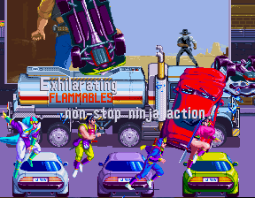

# Mystic Warriors intro-name compatibility

Before 0.2.1, the five ninja name labels could remain red over the scene following
the portraits. The user compared this with Switch Arcade Archives, where they
disappear. MAME reproduces the residue and was not used as a golden image for
the desired absence. Switch footage is a software comparison, not a PCB trace.

## What changed

This is an explicit scene-specific compatibility workaround, not a demonstrated
new sprite-chip rule. It applies only to Mystic Warriors EAA. At each object-list
build it reads all 64 words of the first eight original sprite descriptors
through the existing synchronous snapshot-RAM port. All words must match the
captured name signature (only the two observed Z values are accepted), and
K055555 layer priorities C/D must be 0x50/0x90. Only then are those eight entries
omitted for that build. Recognition resets on every build and reset.

Portrait layout does not activate it. Other sprite descriptors, normal captions
and the Gaiapolis profile bypass it. No original game ROM, program, graphics,
EEPROM or saved data is patched. A universal priority-zero suppression was
rejected because it would hide valid content. The general hardware explanation
remains open; the practical compatibility result is tested on Pocket.

The source parameters default OFF. The released Quartus QSF explicitly defines
`MYSTIC_INTRO_COMPAT=1`, enabling the tested configuration. Remove the assignment
for an OFF diagnostic; the macro's presence is what `ifdef` tests. No extra APF
menu entry is used. See [the implementation](../rtl/k053247_objlist.sv).

## Actual Pocket captures

  
  

Before is Pocket04, the hardware shipped in 0.2.0. After is intro01, whose exact
bitstream is shipped in 0.2.1. These are different moments, not aligned-frame
pixel comparisons. PNG exports preserve the original image scanlines and native
288×224 orientation; only container compression and private trailing bytes were
removed. Original private captures remain unchanged.

  

The ordinary grey caption remains visible. The user confirms that names now
disappear and both games continue to run well. The still images illustrate the
post-portrait scenes; the transition itself is confirmed by user observation.

## Validation and limits

- 126 independently executed component cases, including all 64 individual-word
  signature negatives, original/bypass controls and reset/profile changes.
- Paired OFF/ON rendering: 24 rasters and 4,644,864 accepted consumer pixel
  comparisons across phases and contention. Portraits unchanged; only the
  intended name glyphs differ in the two workaround targets. Those targets
  describe the compatibility effect and are not independent hardware oracles.
- Classified 367 existing capture samples; finite ordinary-scene controls reject
  the signature. This is not a proof of no false positives in every gameplay state.
- New full fit, all timing corners nonnegative; fitted SDRAM, constraints,
  clock-enable and package reviews completed before the physical test.
- Physical Pocket test: disappearance and continued normal operation of both
  games reported by the user. No new complete playthrough or Analogizer test
  is inferred. See [validation scope](VALIDATION.md).
