# Pocket captures — release 0.3

Thirteen original captures from the Pocket-tested three-game candidate. Native
pixels, orientation and decompressed scanlines are preserved without retouching;
PNG trailing data is removed and image data is compressed losslessly. SHA256
and native dimensions are in [the image manifest](images/pocket-0.3/manifest.json).
The final demo scene includes an ordinary transition fade.

### Portrait sequence

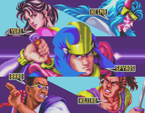

### Intro truck scene

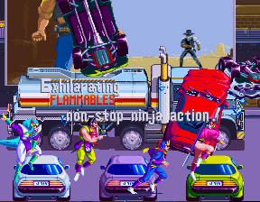

### Final attract/demo scene; ordinary scene-transition fade

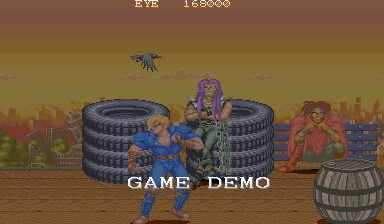

### Wade at the station

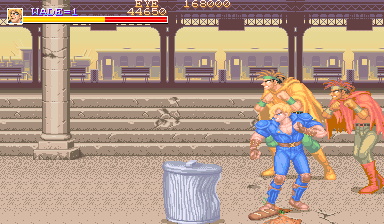

### Wade and Dabel

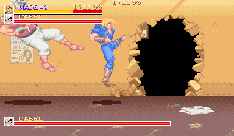

### Stage-clear map

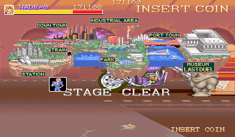

### Second-stage Liza encounter

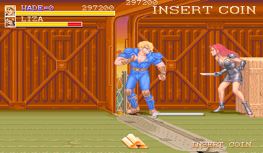

### Second-stage sprite action

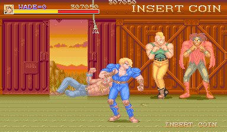

### Eve encounter

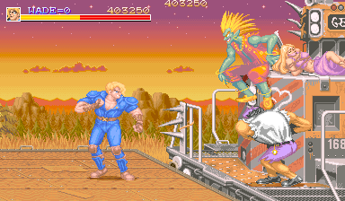

### Kyle stage clear

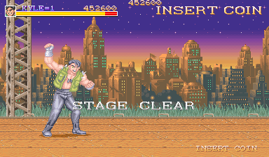

### Stage-clear city map

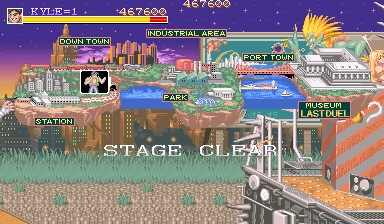

### Vertical intro

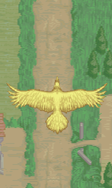

### Vertical gameplay after boss

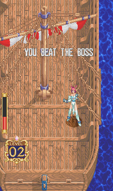

