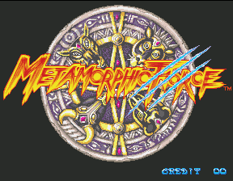
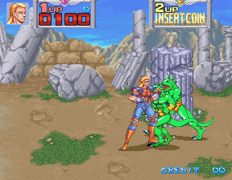
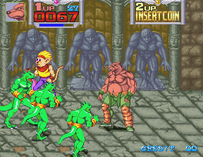
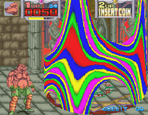
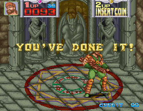
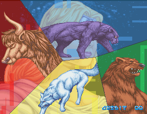
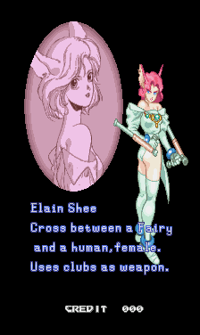

# Pocket0.4 captures

Original Analogue Pocket screenshots,8November2026. PNG CRCs are checked;
IHDR and all decompressed scanlines remain identical. Only lossless compression
and removal of trailing data are applied; no retouching, resizing or rotation.
The main home gallery uses only in-game scenes, with title screens separately.
The confirmation covers reported gameplay and visible scenes, not a complete
playthrough or all multiplayer/save/Analogizer combinations.

## Metamorphic Force

## Additional intro observations

These are diagnostic intro captures, outside the main in-game home gallery.

Per-image hashes, scanline hashes and scene classifications: [manifest](images/pocket-0.4/manifest.json).
